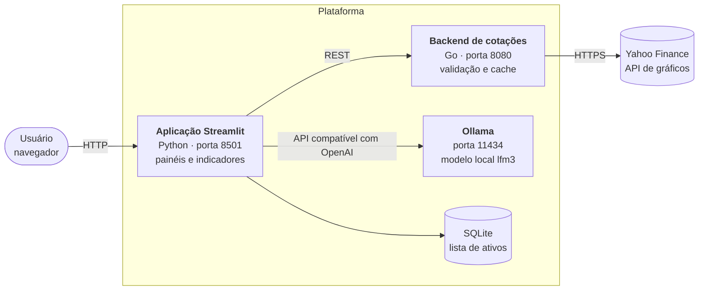
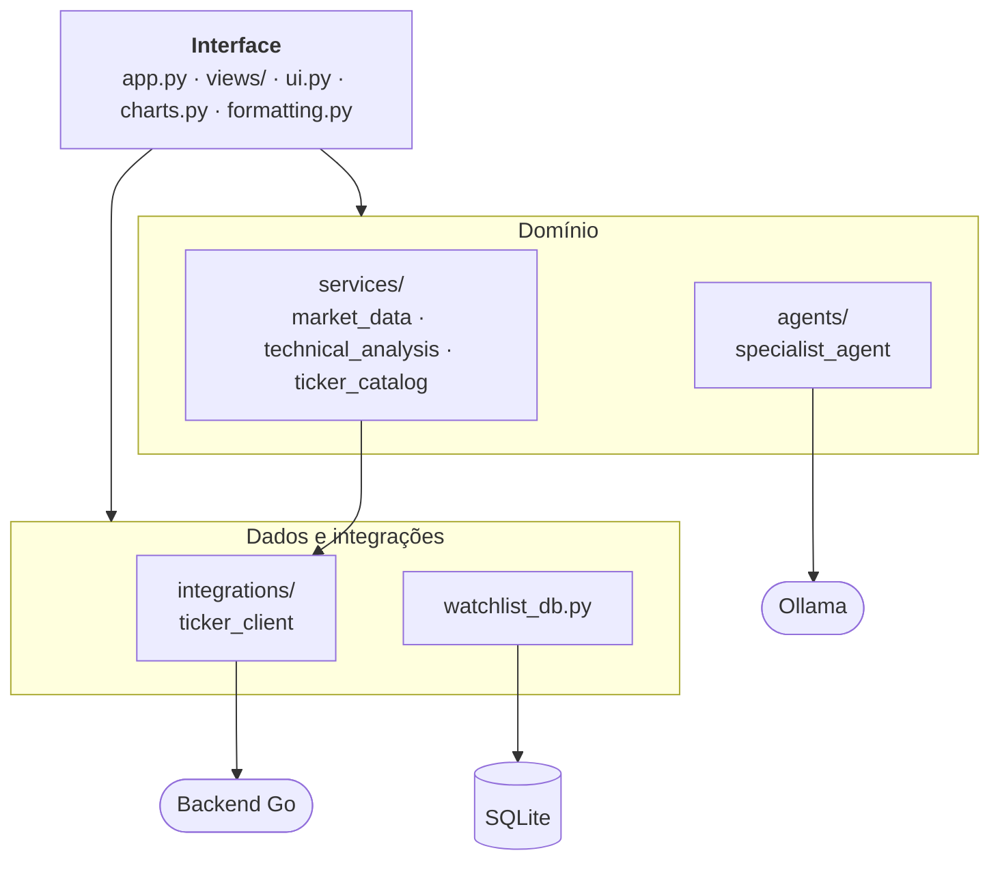
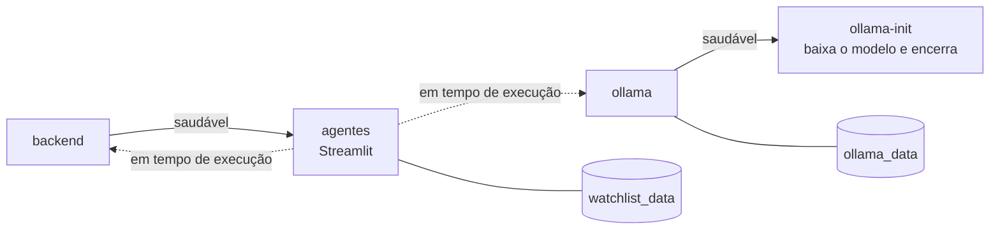
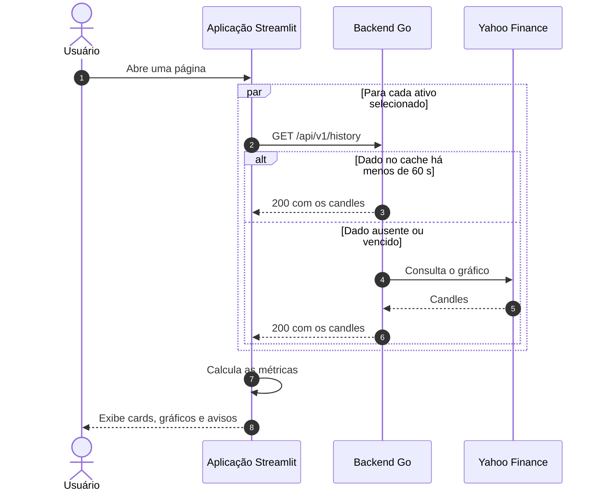
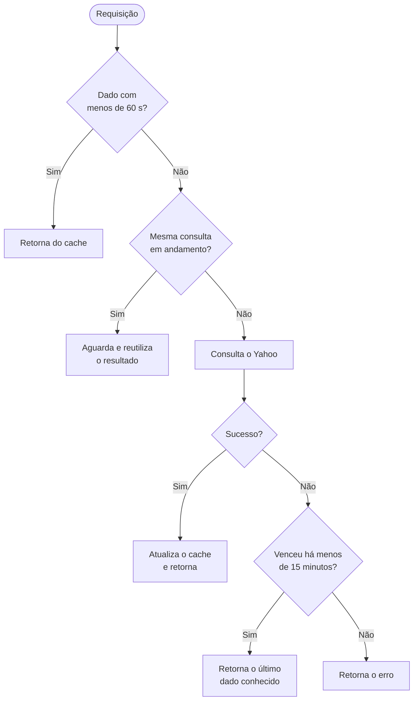
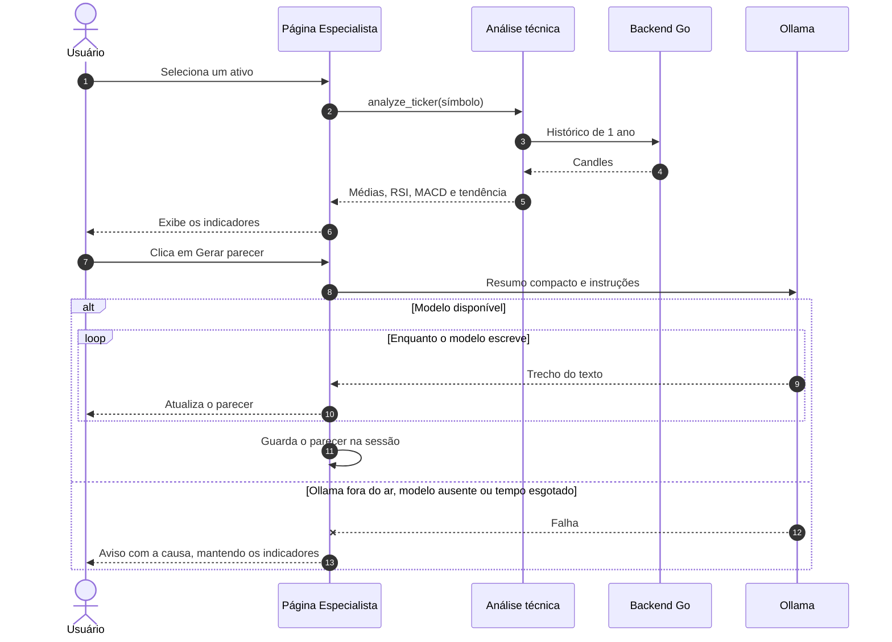
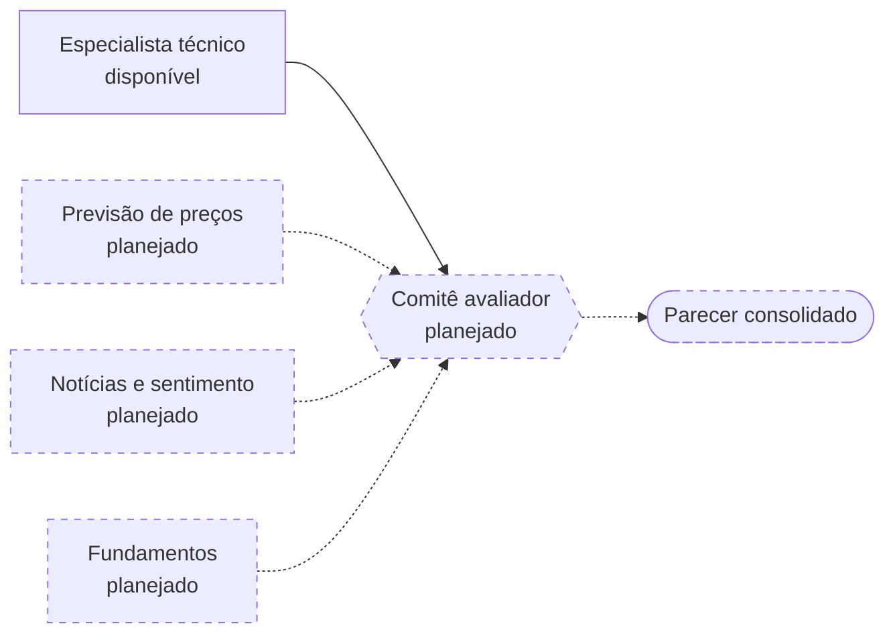

# Plataforma de Agentes de Investimentos

[](backend/go.mod)
[](app/pyproject.toml)
[](app/requirements.txt)
[](https://ollama.com/)
[](LICENSE)

Plataforma para acompanhar ativos, comparar desempenho e obter análises técnicas de ações. Um serviço em **Go** coleta as cotações, uma aplicação **Streamlit** em Python calcula indicadores e exibe os painéis, e um modelo de linguagem executado localmente com **Ollama** redige o parecer técnico. Nenhum dado é enviado a APIs pagas de IA.

> [!IMPORTANT]
> Projeto educacional. As cotações podem ter atraso e os pareceres são gerados por IA a partir apenas de indicadores técnicos, podendo conter erros. **Nada aqui constitui recomendação de investimento.**

## Sumário

- [Funcionalidades](#funcionalidades)
- [Início rápido](#início-rápido)
- [Arquitetura](#arquitetura)
- [Fluxos principais](#fluxos-principais)
- [Indicadores e métricas](#indicadores-e-métricas)
- [API do backend](#api-do-backend)
- [Execução sem Docker](#execução-sem-docker)
- [Configuração](#configuração)
- [Testes e qualidade](#testes-e-qualidade)
- [Segurança](#segurança)
- [Solução de problemas](#solução-de-problemas)
- [Estrutura do projeto](#estrutura-do-projeto)
- [Limitações conhecidas](#limitações-conhecidas)
- [Roadmap](#roadmap)
- [Licença](#licença)

## Funcionalidades

| Página | O que oferece |
|---|---|
| **Início** | Cards com preço, variação do dia, mínima, máxima e evolução do último mês de cada ativo |
| **Mercado** | Candles, volume, resumo do período e tabela de cotações, de 5 dias a 2 anos |
| **Análise** | Comparação da variação acumulada, com retorno, volatilidade anualizada e maior queda de cada ativo |
| **Especialista** | Tendência, RSI, MACD e médias móveis, além de um parecer da IA exibido enquanto é escrito |

Em **Gerenciar ativos**, na barra lateral, você busca entre mais de 1.000 ativos da B3 no catálogo ou informa qualquer código aceito pelo Yahoo Finance, como `AAPL` ou `BTC-USD`. Digitar `petr4` já resolve para `PETR4.SA`. A interface acompanha o tema claro ou escuro.

## Início rápido

**Pré-requisitos:** [Docker Engine](https://docs.docker.com/engine/install/) 24+ com [Docker Compose](https://docs.docker.com/compose/) v2.

```bash
git clone https://github.com/lexanderalfabiotec-cyber/plataforma_agentes_investimentos.git
cd plataforma_agentes_investimentos
cp .env.example .env
docker compose up --build
```

Abra <http://localhost:8501> e clique em **Adicionar ativos**.

As cotações e os indicadores funcionam assim que a interface sobe. O parecer da IA fica disponível quando o download do modelo termina, o que pode levar alguns minutos no primeiro uso.

### Variações

| Objetivo | Comando |
|---|---|
| Rodar em segundo plano | `docker compose up --build -d` |
| Usar GPU NVIDIA ([Container Toolkit](https://docs.nvidia.com/datacenter/cloud-native/container-toolkit/install-guide.html) necessário) | `docker compose -f docker-compose.yml -f docker-compose.gpu.yml up --build` |
| Recarregar o código Python sem rebuild | `docker compose -f docker-compose.yml -f docker-compose.dev.yml up --build` |
| Ver o estado dos serviços | `docker compose ps` |
| Acompanhar os logs | `docker compose logs -f agentes backend` |
| Parar os serviços | `docker compose down` |
| Parar e apagar a lista de ativos e os modelos | `docker compose down -v` |

## Arquitetura



| Componente | Responsabilidade | Tecnologia |
|---|---|---|
| **Backend de cotações** | Valida as requisições, consulta o Yahoo Finance, normaliza candles OHLCV e mantém o cache | Go, somente biblioteca padrão |
| **Aplicação** | Interface, busca paralela, indicadores, métricas e persistência da lista de ativos | Python, Streamlit, Altair, pandas, SQLite |
| **Ollama** | Executa o modelo de linguagem na própria máquina | Modelo `lfm3`, configurável |

### Decisões de projeto

- **Indicadores calculados no Python, não pelo modelo.** Números são determinísticos e testáveis. O modelo recebe um resumo compacto, com as comparações já feitas, e apenas redige a interpretação.
- **Cache em um único lugar.** O backend concentra o cache, o que protege o limite de requisições do Yahoo para todas as sessões e evita dados divergentes entre páginas.
- **Falhas isoladas.** Um ativo sem dados não derruba os demais, e a falta do modelo não afeta cotações nem indicadores.
- **Sem dependências no backend.** O serviço usa só a biblioteca padrão do Go e gera uma imagem de cerca de 26 MB.

### Camadas da aplicação

As dependências seguem em um único sentido, de cima para baixo. A camada de serviços não importa o Streamlit, então os cálculos podem ser testados sem a interface.



### Orquestração com Docker Compose



A interface depende apenas do backend para iniciar. Por isso, um download lento ou com falha não impede o acesso às cotações.

## Fluxos principais

### Consulta de cotações

A aplicação consulta até 8 ativos em paralelo. Cada resultado é tratado separadamente, de modo que a página mostra os ativos disponíveis e explica o que aconteceu com os demais.



### Estratégia de cache

O cache do backend guarda até 2.048 respostas. Requisições simultâneas para a mesma consulta compartilham uma única chamada ao Yahoo, e os últimos dados conhecidos seguram falhas temporárias.



### Parecer do especialista



O resumo enviado ao modelo é uma linha por ativo, sem histórico de candles, o que reduz o tamanho do prompt:

```text
PETR4.SA BRL px=52.71 MA20=55.64(px abaixo) MA50=50.54(px acima) MA200=44.15(px acima) RSI14=46.66 MACD=0.83 sig=1.79 hist=-0.96 trend=alta momentum=negativo
```

## Indicadores e métricas

Os valores são calculados a partir dos fechamentos diários.

| Indicador | Cálculo | Leitura na interface |
|---|---|---|
| **Médias móveis** | Médias simples de 20, 50 e 200 dias, sobre 1 ano de histórico | Base da tendência |
| **Tendência** | **Alta** se preço > MM50 > MM200; **baixa** se preço < MM50 < MM200; caso contrário, **mista**. Sem MM50 ou MM200, compara o preço com a MM20 | Alta, baixa, mista ou indisponível |
| **RSI 14** | Suavização de Wilder em 14 períodos | Acima de 70: sobrecomprado. Abaixo de 30: sobrevendido |
| **MACD** | EMA 12 − EMA 26, com linha de sinal EMA 9 | Histograma positivo ou negativo |
| **Variação do dia** | Último fechamento sobre o fechamento anterior | Início e Mercado |
| **Retorno** | Último fechamento sobre o primeiro do período | Análise |
| **Volatilidade anual** | Desvio-padrão dos retornos diários × √252 | Análise |
| **Maior queda** | Maior recuo em relação a um pico anterior no período | Análise |

## API do backend

Base local: `http://localhost:8080`. Todas as rotas aceitam apenas `GET`.

| Rota | Descrição |
|---|---|
| `GET /health` | Verifica se o serviço está no ar |
| `GET /api/v1/latest` | Retorna o candle mais recente de um ativo |
| `GET /api/v1/history` | Retorna o histórico de candles de um ativo |

### Parâmetros

| Parâmetro | Rotas | Obrigatório | Valores |
|---|---|---|---|
| `symbol` | `latest`, `history` | Sim | Até 24 caracteres entre letras, números e `. ^ = -`. Ex.: `PETR4.SA`, `BTC-USD`, `BRL=X`, `^BVSP` (na URL, `%5EBVSP`) |
| `range` | `history` | Não (`1mo`) | `1d`, `5d`, `1mo`, `3mo`, `6mo`, `1y`, `2y`, `5y`, `10y`, `ytd`, `max` |
| `interval` | `history` | Não (`1d`) | `1m`, `2m`, `5m`, `15m`, `30m`, `60m`, `90m`, `1h`, `1d`, `5d`, `1wk`, `1mo`, `3mo` |

### Exemplos

```bash
curl "http://localhost:8080/api/v1/latest?symbol=PETR4.SA"
```

```json
{
  "symbol": "PETR4.SA",
  "currency": "BRL",
  "candle": {
    "date": "2026-10-30T13:00:00Z",
    "open": 52.45,
    "high": 53.66,
    "low": 52.36,
    "close": 52.71,
    "volume": 61743200
  }
}
```

```bash
curl "http://localhost:8080/api/v1/history?symbol=AAPL&range=1mo&interval=1d"
```

```json
{
  "symbol": "AAPL",
  "currency": "USD",
  "candles": [
    { "date": "...", "open": 0.0, "high": 0.0, "low": 0.0, "close": 0.0, "volume": 0 }
  ]
}
```

### Erros

Os erros de validação e de consulta retornam JSON no formato `{"error": "mensagem"}`. Detalhes internos ficam apenas no log do servidor.

| Status | Quando ocorre | Como a interface apresenta |
|---|---|---|
| `400` | Parâmetro ausente ou inválido | Ativo não encontrado |
| `404` | Ativo inexistente ou sem dados | Ativo não encontrado, com sugestão de removê-lo |
| `405` | Método diferente de `GET` | Não se aplica à interface |
| `502` | Falha do Yahoo sem dado recente em cache | Provedor sem resposta; tente novamente em instantes |

Se o backend estiver inacessível, a interface informa isso e oferece o botão **Tentar novamente**.

## Execução sem Docker

**Pré-requisitos:** [Go](https://go.dev/dl/) 1.27.3+, [Python](https://www.python.org/downloads/) 3.12+ e [Ollama](https://ollama.com/). Use um terminal para cada serviço.

**1. Modelo**

```bash
ollama serve            # dispensável se o Ollama já roda como serviço
ollama pull lfm3
```

**2. Backend**

```bash
cd backend
go run ./cmd
```

**3. Aplicação**

```bash
cd app
python3 -m venv .venv
source .venv/bin/activate
pip install -r requirements.txt
streamlit run app.py
```

Execute `streamlit run` de dentro de `app/`, para que o tema em `.streamlit/config.toml` seja carregado. Fora do Docker, os valores padrão já apontam para `localhost` e não é preciso definir variáveis.

## Configuração

O arquivo `.env` é lido apenas pelo Docker Compose. Na execução local, exporte as variáveis no terminal.

| Variável | Descrição | Padrão local | Padrão no Docker |
|---|---|---|---|
| `OLLAMA_MODEL` | Modelo usado pelo especialista | `lfm3` | `lfm3` |
| `OLLAMA_HOST` | URL do Ollama | `http://localhost:11434` | `http://ollama:11434` |
| `BACKEND_URL` | URL do backend | `http://localhost:8080` | `http://backend:8080` |
| `WATCHLIST_DB_PATH` | Arquivo SQLite da lista de ativos | `app/ativos.db` | `/data/ativos.db` |
| `PORT` | Porta interna do backend | `8080` | `8080` |
| `APP_PORT` | Porta publicada da interface | — | `8501` |
| `BACKEND_PORT` | Porta publicada do backend | — | `8080` |
| `OLLAMA_PORT` | Porta publicada do Ollama | — | `11434` |

Para ampliar o catálogo de ativos, edite [`app/config/ticker.csv`](app/config/ticker.csv), com as colunas `Papel`, `Nome` e `YahooTicker`, e reinicie a aplicação.

## Testes e qualidade

```bash
# Backend: testes unitários e de integração, com detector de condição de corrida
cd backend
go vet ./...
go test -race ./...

# Aplicação: testes, lint e formatação
cd app
pip install -r requirements-dev.txt
pytest
ruff check .
ruff format --check .
```

Os testes não acessam a internet. O Yahoo Finance, o backend e o Ollama são substituídos por stubs.

| Área | O que é coberto |
|---|---|
| **Backend** | Rotas, validação de parâmetros, parser do Yahoo, expiração e compartilhamento do cache, concorrência |
| **Aplicação** | Indicadores, métricas, busca paralela com falhas isoladas, tradução de erros, formatação, catálogo, SQLite e erros do modelo |

## Segurança

- **Exposição:** o Compose publica as portas somente em `127.0.0.1`. O projeto não tem autenticação, então coloque um proxy autenticado à frente antes de expor o serviço em uma rede.
- **Entrada:** o backend valida símbolo, período e intervalo por listas e padrões permitidos, e aplica escape na URL enviada ao Yahoo.
- **Contêineres:** a aplicação e o backend rodam com usuários sem privilégios de root.
- **Mensagens de erro:** as respostas e a interface não exibem detalhes internos nem stack traces.
- **Privacidade:** os pareceres são gerados na sua máquina. O Yahoo Finance recebe apenas os códigos dos ativos consultados.

## Solução de problemas

| Sintoma | Causa provável | Solução |
|---|---|---|
| `port is already allocated` na porta 11434 | Já existe um Ollama na máquina | Defina outro `OLLAMA_PORT` no `.env` |
| `port is already allocated` em outra porta | Outro serviço usa a porta | Altere `APP_PORT` ou `BACKEND_PORT` no `.env` |
| "Não foi possível conectar ao serviço de cotações" | Backend parado | Verifique com `docker compose ps` e `curl localhost:8080/health` |
| "O provedor de cotações não respondeu" | Yahoo indisponível ou limite de requisições | Aguarde alguns instantes e tente novamente |
| "O modelo de IA não está instalado" | Download ainda em andamento ou com falha | Veja `docker compose logs ollama-init` e, se preciso, rode `docker compose exec ollama ollama pull lfm3` |
| "Não foi possível conectar ao serviço de IA" | Ollama parado | Verifique o serviço; cotações e indicadores continuam funcionando |
| Parecer demora a começar | O modelo está sendo carregado ou roda na CPU | Aguarde. Sem GPU, a primeira resposta levou mais de 1 minuto em nossos testes |
| "Não encontramos" ao adicionar um ativo da B3 | Códigos fora do catálogo exigem o sufixo `.SA` | Informe o código completo, como `PETR4.SA` |

## Estrutura do projeto

```text
plataforma_agentes_investimentos/
├── docker-compose.yml            # Serviços: ollama, ollama-init, backend e agentes
├── docker-compose.gpu.yml        # Opcional: GPU NVIDIA para o Ollama
├── docker-compose.dev.yml        # Opcional: recarga do código Python
├── .env.example                  # Modelo de configuração
├── backend/                      # Serviço de cotações em Go
│   ├── cmd/                      # Servidor HTTP e testes de integração
│   ├── internal/
│   │   ├── cache/                # TTL, carga compartilhada e último dado conhecido
│   │   ├── handlers/             # Validação e rotas
│   │   └── yahoo/                # Cliente e parser do Yahoo Finance
│   └── Dockerfile
└── app/                          # Aplicação Python
    ├── app.py                    # Entrada e navegação
    ├── .streamlit/config.toml    # Tema e configuração do Streamlit
    ├── config/
    │   ├── ticker.csv            # Catálogo de ativos
    │   └── settings.yaml         # Modelos e prompts reservados ao roadmap
    ├── views/                    # Páginas da interface
    ├── src/investment_agents/
    │   ├── agents/               # Especialista técnico
    │   ├── integrations/         # Cliente HTTP do backend
    │   ├── services/             # Dados de mercado, indicadores e catálogo
    │   ├── charts.py             # Gráficos Altair
    │   ├── formatting.py         # Formatação no padrão brasileiro
    │   ├── ui.py                 # Componentes compartilhados
    │   └── watchlist_db.py       # Persistência em SQLite
    ├── tests/                    # Testes com pytest
    ├── requirements.txt          # Dependências da aplicação
    ├── requirements-dev.txt      # Testes e lint
    ├── requirements-ml.txt       # Reservado aos agentes do roadmap
    └── Dockerfile
```

> [!NOTE]
> A pasta de páginas se chama `views/` de propósito. O Streamlit trata uma pasta `pages/` como navegação automática, o que quebra links diretos e ignora o `app.py`.

## Limitações conhecidas

- **Fonte de dados:** o projeto usa um endpoint público não oficial do Yahoo Finance, que pode mudar, limitar requisições ou atrasar cotações.
- **Dados em contingência:** se o Yahoo falhar, os últimos dados conhecidos podem ser exibidos por até 15 minutos além do cache, sem aviso específico na interface.
- **Lista única:** não há login, então todos que acessam a instância compartilham a mesma lista de ativos.
- **Qualidade do parecer:** o modelo local pode interpretar mal os indicadores. Ele não considera notícias, fundamentos nem o seu perfil de investidor.
- **Comparação entre moedas:** a página Análise compara variações na moeda de cada ativo, sem conversão cambial.

## Roadmap

Ainda não implementado. As dependências reservadas estão em `app/requirements-ml.txt`, e os prompts em `app/config/settings.yaml`.



## Licença

Distribuído sob a [licença MIT](LICENSE).
